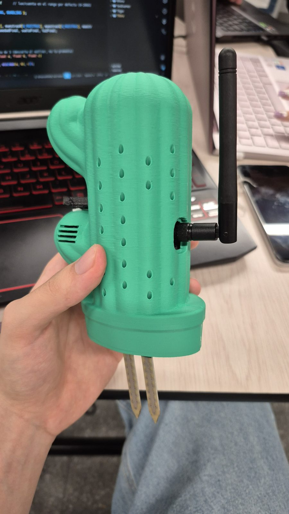
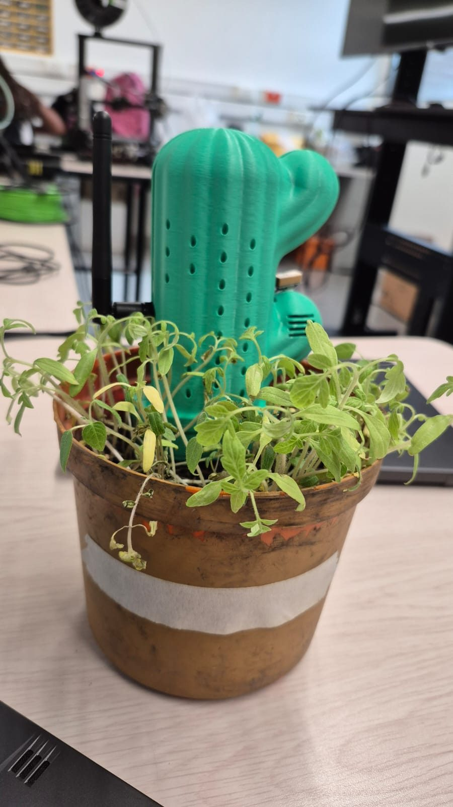
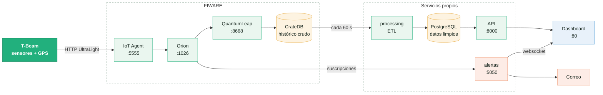

# Sistema de monitoreo de plantas IoT

Construido a partir de un nodo LilyGO T-Beam alojado en una carcasa con forma de cactus, impresa en 3D, que se clava en la tierra junto a la planta. Cada 10 s el nodo mide temperatura, humedad del aire, humedad del suelo, luz y posición GPS, y envía una trama UltraLight 2.0 a una nube basada en FIWARE.

La nube guarda el histórico, limpia y clasifica los datos, y los muestra en un dashboard web con los valores en vivo, las gráficas por rango de fechas y una vista 3D del nodo. Si la temperatura sale de rango, envía alertas por correo y websocket.

<p align="center">
  
  &nbsp;
  
  <br>
  <em>El nodo en su carcasa impresa en 3D - y midiendo en una maceta.</em>
</p>

## Montaje y despliegue

### Requisitos

- **Hardware:** LilyGO T-Beam V1.1, HDC1080, AP3216, módulo de humedad de suelo (LM393, alimentado a 3,3 V) y cable USB de datos.
- **Software:** [PlatformIO](https://platformio.org/install/cli), y Docker con Compose v2 en el servidor.

### Pasos

1. **Cablear el nodo** según la [tabla de pines](docs/conexion-sensor.md#1-cableado-t-beam-v11): los dos sensores I2C en `21`/`22` y el de suelo en `GPIO36`. No usar `GPIO0` ni `GPIO4`, porque no leen con el WiFi encendido.
2. **Levantar la nube** en el servidor. En `.env` llenar, al menos, `ALERTAS_TOKEN` (`openssl rand -hex 16`) y los `SMTP_*`; la [plantilla](nube/.env.example) explica cada variable.
   ```bash
   git clone https://github.com/dano796/iot-plant-monitoring-system.git && cd iot-plant-monitoring-system/nube
   cp .env.example .env
   docker compose up -d --build
   ```
3. **Crear las suscripciones de alertas** en Orion. Se puede repetir sin duplicar; hay que volver a correrlo si cambian los umbrales.
   ```bash
   docker exec fiware-alertas python suscripciones.py
   ```
4. **Configurar las credenciales del nodo** en [`secretos.h`](docs/conexion-sensor.md#2-firmwaresrcsecretosh): WiFi y URL del IoT Agent con la apikey del [grupo de servicio](docs/arquitectura.md#iot-agent).
   ```bash
   cd firmware && cp src/secretos.example.h src/secretos.h
   ```
5. **Flashear la T-Beam** conectada al portátil y revisar el serial:
   ```bash
   pio run -t upload && pio device monitor
   ```
6. **Calibrar el sensor de suelo** con una lectura al aire y otra en agua ([cómo](docs/conexion-sensor.md#4-calibrar-el-sensor-de-suelo-firmwaresrcmaincpp)).
7. **Abrir el dashboard** en `http://<servidor>`. El procesamiento corre cada 60 s, así que el primer dato puede tardar un minuto. Si no aparece, seguir la [verificación en la nube](docs/conexion-sensor.md#5-verificar-en-la-nube).

## Cómo funciona



- **El nodo** ([`firmware/`](firmware/)) toma 3 muestras de cada sensor, se queda con la mediana y envía la trama por HTTP. Detalle en [el emisor](docs/arquitectura.md#nodo-sensor).
- **FIWARE** traduce la trama a una entidad NGSI-v2 (IoT Agent) y guarda el estado actual (Orion) y el histórico crudo (QuantumLeap + CrateDB).
- **El ETL** ([`nube/processing/`](nube/processing/)) limpia y clasifica cada minuto lo nuevo y lo deja en PostgreSQL. La **API** ([`nube/api/`](nube/api/)) lo sirve al **dashboard** ([`nube/frontend/`](nube/frontend/)).
- **Las alertas** ([`nube/alertas/`](nube/alertas/)) no consultan la base: Orion les avisa cuando una lectura cumple la regla, y una máquina de estados decide cuándo mandar el correo y el banner. Detalle en la [guía de alertas](docs/alertas.md).

| Servicio | Puerto | Para qué |
|---|---|---|
| Dashboard | 80 | Interfaz web |
| API | 8000 | `/api/plantas/ultimo`, `/historico`, `/rango` |
| Alertas | 5050 | `/estado` y websocket `/ws` (lo usa el dashboard) |
| IoT Agent | 5555 | Recibe las tramas del nodo |
| Orion, IoT Agent (admin), CrateDB, QuantumLeap | 1026, 4041, 4200, 8668 | Administración: no exponer a internet |

## Documentación

| Documento | Contenido | Diagrama editable |
|---|---|---|
| [Arquitectura](docs/arquitectura.md) | Componentes del sistema y recorrido de una lectura, del nodo al dashboard | [sistema.drawio](docs/diagramas/sistema.drawio) |
| [Alertas](docs/alertas.md) | Regla, estados y avisos por correo y en el dashboard | [alertas.drawio](docs/diagramas/alertas.drawio) |
| [Conexión del sensor](docs/conexion-sensor.md) | Cableado, calibración y verificación del nodo | - |

## Desarrollado por

- Daniel Ortiz Aristizábal
- Emanuel Londoño Osorio
- Valeria Zuluaga Alzate

### Internet de las Cosas - Universidad Pontificia Bolivariana
