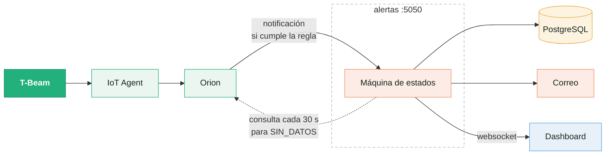
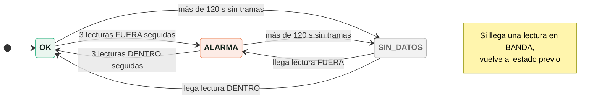

# Sistema de alertas

Cómo detecta el sistema que la temperatura salió de rango y cómo avisa por correo y en el dashboard. Diagrama editable: [diagramas/alertas.drawio](diagramas/alertas.drawio).

El servicio no consulta la base de datos: funciona por eventos. La regla vive en Orion como dos suscripciones; cuando una lectura la cumple, Orion notifica al servicio `alertas` ([nube/alertas/](../nube/alertas/)), que decide con una máquina de estados si hay que avisar. Cada cambio de estado produce un correo y un aviso en el dashboard.



## Regla

[suscripciones.py](../nube/alertas/suscripciones.py) crea dos suscripciones en Orion sobre `Plant:plant001`. Con los umbrales por defecto:

| Suscripción | Condición | Notifica cuando |
|---|---|---|
| Fuera de rango | `temperatura!=10..30;temperatura==0..60` | La temperatura sale de 10-30 °C |
| Dentro de rango | `temperatura==12..28` | La temperatura vuelve a 12-28 °C |

- Entre 10-12 y 28-30 °C ninguna notifica. Ese margen evita avisos repetidos cuando la temperatura oscila cerca del límite.
- Las lecturas fuera de 0-60 °C se consideran inválidas (por ejemplo, los 125 °C de un sensor desconectado) y no notifican.
- Orion notifica cada lectura, aunque repita el valor anterior, para que se puedan contar lecturas seguidas.

## Estados



| Estado | Significado |
|---|---|
| `OK` | Temperatura normal. Es el estado inicial |
| `ALARMA` | Fuera de rango, confirmado con 3 lecturas seguidas |
| `SIN_DATOS` | No llega ninguna trama hace más de 120 s |

- Pedir 3 lecturas seguidas evita que un pico aislado dispare una alarma. Una lectura en el lado contrario reinicia la cuenta.
- Como Orion no notifica nada cuando la placa se apaga, el servicio consulta la entidad en Orion cada 30 s para detectar `SIN_DATOS`.
- Una lectura repetida o atrasada se ignora, así que una notificación duplicada no cuenta dos veces.
- El estado se guarda en PostgreSQL: reiniciar el servicio no repite correos ni pierde la cuenta.

## Avisos

**Correo.** Uno por cada cambio de estado, con el valor, la hora y un enlace al dashboard:

```
ALARMA: temperatura-plant001 en ALARMA (36.0 °C > 30 °C)
OK: temperatura-plant001 volvió a OK (25.0 °C)
SIN DATOS: temperatura-plant001 sin datos desde 14:32
```

Si el envío falla, se reintenta cada 30 s en orden. Los avisos con más de una hora de retraso se descartan para no mandar una ráfaga vieja.

**Dashboard.** Se conecta al servicio por websocket (puerto 5050) y muestra un banner:

| Estado | Banner |
|---|---|
| `ALARMA` | Rojo, fijo, y la tarjeta de temperatura resaltada |
| `SIN_DATOS` | Gris, fijo |
| Vuelta a `OK` | Verde durante 5 s |

## Configuración

Variables en `nube/.env` (plantilla: [.env.example](../nube/.env.example)):

| Variable | Por defecto | Uso |
|---|---|---|
| `ALERTAS_TOKEN` | Obligatoria | Secreto que Orion envía al notificar. Generar con `openssl rand -hex 16` |
| `SMTP_HOST`, `SMTP_PORT` | `smtp.gmail.com`, `465` | Servidor de correo |
| `SMTP_USER`, `SMTP_PASS` | - | Cuenta y contraseña de aplicación |
| `ALERTA_DESTINO` | - | Destinatarios, separados por coma |
| `FRONT_URL` | - | Enlace al dashboard en el correo |
| `TEMP_MIN`, `TEMP_MAX` | 10, 30 | Rango normal |
| `HISTERESIS` | 2 | Margen para volver a OK |
| `CONFIRMACIONES` | 3 | Lecturas seguidas para cambiar de estado |
| `SIN_DATOS_S` | 120 | Segundos sin tramas para `SIN_DATOS` |
| `VALIDO_MIN`, `VALIDO_MAX` | 0, 60 | Rango físico válido |

Después de cambiar los umbrales hay que reiniciar el servicio y volver a crear las suscripciones:

```bash
docker compose up -d alertas
docker exec fiware-alertas python suscripciones.py
```

## Prueba

[demo.sh](../nube/alertas/demo.sh) envía tramas falsas al IoT Agent, sin necesidad de la placa:

| Comando | Resultado esperado |
|---|---|
| `APIKEY=<apikey> nube/alertas/demo.sh <servidor> 36` | Correo de ALARMA y banner rojo |
| `... demo.sh <servidor> 29` | Nada cambia (margen) |
| `... demo.sh <servidor> 25` | Correo de OK y banner verde |
| `... demo.sh <servidor> 125` | Nada (lectura inválida) |
| Placa apagada más de 2 min | Correo de SIN DATOS y banner gris |

Para ver en qué estado está la alerta sin abrir el dashboard:

```bash
curl <servidor>:5050/estado
```

Las pruebas automáticas del servicio están en [tests/](../nube/alertas/tests/):

```bash
cd nube/alertas
pip install -r requirements.txt -r requirements-dev.txt
pytest
```
