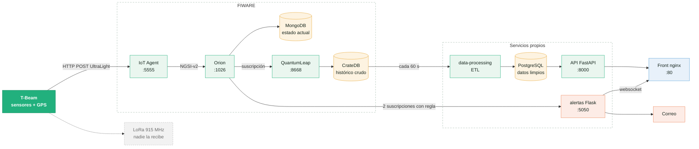

# Arquitectura

Componentes del sistema y recorrido de una lectura, desde el nodo hasta el dashboard. El servicio de alertas tiene su propia guía en [alertas.md](alertas.md) y el montaje del hardware está en [conexion-sensor.md](conexion-sensor.md). Diagrama editable: [diagramas/sistema.drawio](diagramas/sistema.drawio).



## Componentes

| Componente | Rol | Código o imagen |
|---|---|---|
| Nodo T-Beam | Mide y envía una lectura cada 10 s | [firmware/](../firmware/) |
| IoT Agent UltraLight | Traduce las tramas del nodo a entidades NGSI-v2 | `fiware/iotagent-ul` |
| Orion Context Broker | Guarda el estado actual y avisa de cada cambio | `fiware/orion` + MongoDB |
| QuantumLeap | Guarda cada cambio como una fila de histórico | `orchestracities/quantumleap` + CrateDB |
| data-processing | ETL: limpia y clasifica el histórico | [nube/processing/](../nube/processing/) |
| API | Sirve los datos limpios al dashboard | [nube/api/](../nube/api/) |
| alertas | Avisa por correo y websocket cuando la temperatura sale de rango | [nube/alertas/](../nube/alertas/) |
| Front | Dashboard web, servido por nginx | [nube/frontend/](../nube/frontend/) |

Todos corren como contenedores de [docker-compose.yml](../nube/docker-compose.yml) en la misma red.

## Recorrido de una lectura

### Nodo sensor

El firmware ([main.cpp](../firmware/src/main.cpp)) repite tres estados cada 10 s:

1. **CHIRP:** toma 3 muestras de cada sensor, separadas 1 s: temperatura y humedad del aire (HDC1080), luz (AP3216), humedad del suelo (analógico en GPIO36) y posición GPS.
2. **PRUNNING:** se queda con la mediana de cada variable.
3. **BUNDLING:** arma una trama UltraLight 2.0 y la envía por HTTP al IoT Agent.

```
POST http://<servidor>:5555/iot/d?k=<apikey>&i=plant001
Content-Type: text/plain

temperatura|24.5|humedad|61.2|humedadSuelo|40|luz|120.6|lat|4.711|lon|-74.07
```

La misma trama sale también por LoRa (915 MHz), pero no hay ningún gateway que la reciba.

### IoT Agent

Es el punto de entrada de los dispositivos a FIWARE. Recibe las tramas UltraLight en el puerto 5555 y las convierte en entidades NGSI-v2, el formato que entiende Orion. No guarda historia ni transforma los valores.

- La **apikey** (`k`) identifica el *grupo de servicio*, que define a qué servicio de Orion va el dato (`openiot`) y de qué tipo es la entidad (`Plant`).
- El **id** (`i`) identifica el dispositivo. La entidad resultante se llama `Plant:plant001`.
- Por cada trama hace un *upsert* en Orion: crea la entidad si no existe o actualiza sus atributos.
- Su API de administración (puerto 4041) es donde se crean los grupos de servicio y los dispositivos.

Como el dispositivo no declara el tipo de sus atributos, llegan a Orion como `Text` aunque el valor sea numérico. Por eso el ETL convierte las columnas a número.

### Orion y QuantumLeap

Orion guarda solo el **estado actual** de cada entidad, en MongoDB: cada trama sobrescribe la anterior. Además tiene suscripciones que avisan de cada cambio:

- a **QuantumLeap**, que lo agrega como una fila nueva en CrateDB (tabla `mtopeniot.etplant`), el histórico crudo;
- al servicio de **alertas**, solo cuando la temperatura cumple la regla. El detalle está en [alertas.md](alertas.md).

### ETL

[processing/main.py](../nube/processing/main.py) corre cada 60 s:

| Etapa | Qué hace |
|---|---|
| Extract | Lee de CrateDB solo las filas posteriores al último timestamp ya procesado |
| Transform | Convierte a número y descarta lo fuera de rango (temperatura 0-60 °C, humedades 0-100 %). Clasifica cada lectura por humedad del suelo: `NECESITA_RIEGO` (< 30), `OPTIMO` o `EXCESO_AGUA` (> 80) |
| Load | Inserta las filas limpias en PostgreSQL, tabla `mediciones_limpias` |

### API y dashboard

La API (FastAPI, puerto 8000) consulta PostgreSQL en cada petición:

| Endpoint | Devuelve |
|---|---|
| `GET /api/plantas/ultimo` | La última lectura limpia |
| `GET /api/plantas/historico` | Las últimas 50 |
| `GET /api/plantas/rango?desde=&hasta=&puntos=` | Promedios por ventana entre dos instantes, para la pestaña de históricos |

El dashboard consulta la API cada 5 s y escucha el websocket de alertas. Entre la medición y su aparición en el dashboard pasa alrededor de un minuto, por el ciclo del ETL.

## Almacenamiento

| Base | Escribe | Cómo | Contiene |
|---|---|---|---|
| MongoDB | Orion | Sobrescribe una entidad por dispositivo | Estado actual |
| CrateDB | QuantumLeap | Agrega una fila por cada cambio | Histórico crudo |
| PostgreSQL | ETL y alertas | Agrega solo las filas nuevas | Histórico limpio y estado de las alertas |
